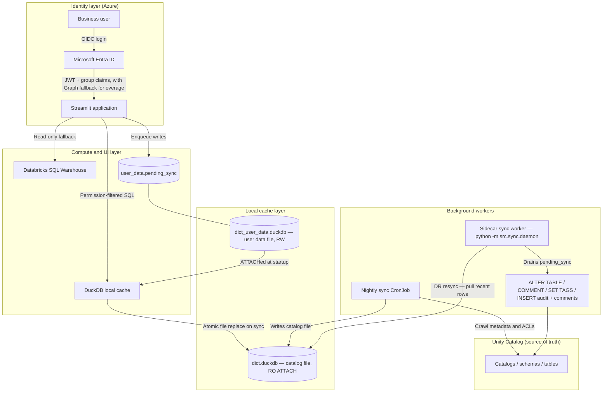

# Architecture overview

Business Data Dictionary for Databricks Unity Catalog. This document describes the system design, component responsibilities, data flows, and key architectural decisions.

---

## System architecture

The solution has four layers: identity, compute/UI, local cache, and the Databricks Unity Catalog source of truth.



---

## Core components

### Identity and security layer

Authentication uses the OAuth 2.0 / OpenID Connect flow against Microsoft Entra ID. The app extracts Security Group Object IDs from the `groups` claim in the ID token. No additional database lookup is needed to resolve group membership — the signed token is the proof. Comma-separated group env vars (`ADMIN_GROUPS`, `PIPELINE_GROUPS`, `EDITOR_GROUPS`) are parsed by `_parse_groups()`, an LRU-cached helper in `src/auth.py`, so the string splitting cost is paid once per unique env value rather than on every RBAC check.

In local development, setting `ENABLE_MOCK_AUTH=true` and `ENVIRONMENT=development` replaces the Entra ID redirect with department-specific mock login buttons (finance, research, hr, it).

### Metadata sync job

`scripts/sync_metadata.py` uses the `databricks-sdk` (`WorkspaceClient`) to crawl the Unity Catalog hierarchy: catalogs → schemas → tables → columns → grants → lineage edges.

Output is written to:

- The Databricks `data_governance.dictionary_cache` schema (truncate-and-reload via SQL Warehouse)
- A local DuckDB file at `DUCKDB_PATH` (atomic swap via `os.replace` so in-flight reads are never interrupted)

A separate script, `scripts/nightly_sync.py`, is the entry point for the CronJob container. The in-app DR resync worker is a different, lighter process (see below).

### DuckDB local cache layer

When `DUCKDB_PATH` is set, the app serves all read queries from a local DuckDB file instead of routing them across the network to the SQL Warehouse. This reduces median query latency from ~300 ms (network round-trip) to under 5 ms for typical search queries on the 800-table reference dataset.

Two files are used:

| File | Owner | Contents |
|------|-------|----------|
| `DUCKDB_PATH` (e.g. `dict.duckdb`) | Sync job | `tables_metadata`, `columns_metadata`, `permissions_cache`, `lineage_cache`, `object_tags`, `audit_log` — rebuilt atomically on each sync |
| `USER_DATA_PATH` (auto-derived as `dict_user_data.duckdb`) | App | `user_data.comments`, `user_data.business_name_overrides`, `user_data.audit_log` — append-only, never touched by the sync job |

At startup the app opens the catalog file and `ATTACH`es the user data file as the `user_data` schema. This enables cross-file JOINs (e.g. joining `tables_metadata` with `user_data.business_name_overrides`). All writes are serialized through a singleton connection and a `threading.Lock`.

The `_to_duckdb_sql()` function translates Databricks SQL dialect to DuckDB SQL (parameter style `%s` → `?`, function aliases, etc.) so the same query strings work against both backends.

### Sidecar sync worker

A separate process (`python -m src.sync.daemon`, deployed as `dd-sync-worker` with `replicas: 1`) drains `user_data.pending_sync` to Databricks and runs DR resync (pulling late-arriving rows from Databricks back into the local user_data file). The Streamlit pods only ever enqueue; the daemon is the sole intentional Databricks writer. See `docs/adr/004-sidecar-sync-worker.md` and `docs/runbooks/sync-worker.md`.

The previous in-process daemon thread (`_start_sync_worker_thread`) was removed in TODO #1 — it shared a Streamlit-cached DuckDB connection with the UI, ran from a thread without a `ScriptRunContext`, and tracked UI activity in two diverging state objects. The sidecar resolves all three.

The daemon writes its status (heartbeat ISO timestamp, DR resync state) into `user_data.site_settings` so the admin sync panel can display it; an HTTP `/healthz` listener returns 503 when the heartbeat goes stale (>60 s by default).

### Streamlit frontend

`app.py` is the Streamlit entry point. It implements five tabs (search, catalog, discovery, health, glossary) and an admin panel, all within a single-page layout using custom tab-based navigation.

The design system CSS is injected via `st.markdown('<style>...</style>')` at startup. All Unity Catalog identifiers (`catalog.schema.table`) are rendered in `JetBrains Mono`. The only accent color is oxidized red `#B8362A` (CSS variable `--accent`).

---

## Storage pattern

Each data-layer module branches inline on `is_demo_mode()`: demo mode
reads and writes `st.session_state`, otherwise rows persist to
`user_data.*` tables in DuckDB.

| Entity | Module | Demo store |
| -- | -- | -- |
| CMS posts | `src/cms.py` | `_demo_cms_posts` (session) |
| Pipeline definitions / runs | `src/pipelines.py` | `_demo_pipelines` / `_demo_run_<id>` (session) |
| User preferences / site settings | `src/personalization.py` | no-op (defaults apply) |
| Audit log / business name overrides | `src/audit.py` | `demo_audit_log`, `demo_business_names`, `demo_table_business_names` (session) |
| Notifications | `src/notifications.py` | `_demo_notifications` (session) |
| Search analytics | `src/analytics.py` | `demo_analytics` (session) |

The earlier Protocol-based `src/storage/` layer (ADR 005) was collapsed
in the 2026-06 over-engineering audit — the abstraction tripled the code
per entity for a test-isolation benefit that patching `is_demo_mode()`
achieves directly. Databricks-direct writes were removed in TODO #7;
the sidecar daemon is the sole Databricks writer.

---

## Security model

### Push-down SQL authorization

Permission enforcement happens inside the SQL engine, not in Python. Every user-facing query that returns tables JOINs `tables_metadata` with `permissions_cache WHERE principal IN ($user_groups)`. Rows for tables the user is not authorized to see are excluded before they reach the application layer.

The sentinel value `SELECT_ALL_USERS` in `permissions_cache.principal` marks publicly accessible tables. These rows appear in search results for all authenticated users regardless of group membership.

The `_to_duckdb_sql()` function ensures parameter substitution is correctly translated between backends. Named parameters in Databricks SQL (`%(name)s`) are converted to positional parameters (`?`) for DuckDB, preserving the parameterized-query pattern in both modes and avoiding SQL injection via concatenation.

### Feature-level access control

- `EDITOR_GROUPS`: comma-separated group IDs allowed to save business name overrides and comments.
- `ADMIN_GROUPS`: comma-separated group IDs allowed to access the admin dashboard and audit logs. There is no demo bypass for admin access.
- `PIPELINE_GROUPS`: comma-separated group IDs whose members can trigger / cancel pipeline runs.

Every write function (`create_post`, `delete_post`, `create_pipeline_def`, `delete_pipeline_def`, `trigger_pipeline`, `cancel_run`, `set_editing_enabled`, `save_business_name`, `save_table_metadata`) re-checks `is_admin()` / `is_pipeline_user()` at the function boundary and raises `PermissionError` on failure — defense-in-depth for the cases where the UI gate isn't the only line. Tests assert the rejection path leaves storage untouched.

Immutable runtime filesystem: both `dd-app` and `dd-sync-worker` pods run with `readOnlyRootFilesystem: true`. A `/tmp` `emptyDir` volume is mounted to allow Streamlit and DuckDB to write ephemeral state without relaxing the root constraint.

User-supplied display names are HTML-escaped at point of use before rendering. SMTP headers are sanitized to prevent header injection in comment notification emails.

### Entra groups overage

When an Entra user belongs to more than ~150 security groups the ID token omits the inline `groups` claim and adds `_claim_names.groups` pointing at Microsoft Graph. `src/auth_graph.py` detects this shape and calls `POST /v1.0/me/getMemberObjects {"securityEnabledOnly": true}` to fetch the transitive list, paginated and capped at 50 pages. Results are kept in a process-level cache (per user OID, 1 h TTL, lock-protected) so they survive across browser tabs.

Failure modes (Graph 4xx/5xx, network) return an empty list and log a warning — fail-closed. Admins can flush every cached entry from the admin page (`§ Group permissions cache → Flush groups cache`) when granting a user a new group; sign-out also drops the user's entry so "sign out, sign back in" picks up new groups immediately.

---

## Personalisation persistence

User personalisation data (bookmarks, recently viewed tables, column bookmarks) is stored in a separate DuckDB file (`USER_DATA_PATH`). This file is append-only from the app's perspective and is never modified by the sync job.

The user is identified by their Entra ID Object ID (`oid` claim), stored as `user_oid` on every preference row. Preferences are loaded into `st.session_state` at session start via `_sync_prefs_to_session()` and written back immediately on user action through `_pref_upsert()` / `_pref_delete()`.

---

## Internationalisation (i18n)

The app supports English and French. Locale files live in `locale/`:

```
locale/
  en.json    English strings (default)
  fr.json    French strings
```

The active locale is stored in `st.session_state.locale` and defaults to `"en"`. Users toggle it with the `EN / FR` control in the header.

All user-visible strings are retrieved through the `t(key)` function:

```python
# Dot-separated key addressing nested JSON structure
label = t("search.placeholder")           # "Search tables or columns..."
msg   = t("search.results_count", count=n) # "{count} results" → "42 results"
```

`t()` looks up the key in the active locale dict, falls back to English if the key is missing in the French file, and performs `str.format_map()` substitution for `{placeholder}` tokens. See `docs/api/locale-keys.md` for the full key reference with EN and FR values side by side.

---

## Glossary and business semantics

The business glossary is generated dynamically from Unity Catalog metadata properties:

| Glossary field | Unity Catalog source | Cache table |
|---------------|---------------------|-------------|
| Term name | Table or column name | `tables_metadata` |
| Definition | Primary `COMMENT` | `tables_metadata` |
| Calculation | Tag with key `calculation` | `object_tags` |
| Domain | Schema tag with key `domain` | `object_tags` |
| Steward | Table tag with key `steward` | `object_tags` |
| Linked tables | Table lineage edges (multi-hop via `WITH RECURSIVE` CTE) | `lineage_cache` |

---

## Cache tables reference

All tables live in `data_governance.dictionary_cache` on Databricks and in the root schema of the DuckDB file.

| Table | Grain | Key columns |
|-------|-------|-------------|
| `tables_metadata` | One row per table | `full_name`, `description`, `table_type` |
| `columns_metadata` | One row per column | `full_name`, `column_name`, `data_type`, `description` |
| `permissions_cache` | One row per (table, principal, privilege) | `full_name`, `principal`, `privilege` |
| `lineage_cache` | One row per lineage edge | `source_table`, `target_table`, `hop` |
| `object_tags` | One row per (object, tag key) | `full_name`, `tag_key`, `tag_value` |

`setup_cache_tables()` in `scripts/sync_metadata.py` creates all tables with `IF NOT EXISTS`. It is safe to run repeatedly and is called at the start of every sync.

---

## Deployment topology

In Kubernetes the solution runs as:

- A `Deployment` (`dd-app`) for the Streamlit UI, scaled by HPA (replicas managed by `k8s/hpa.yaml`). Probes target `/_stcore/health` on port 8501. A `PodDisruptionBudget` keeps `minAvailable: 1` during node drains. Runs with `readOnlyRootFilesystem: true`; a `/tmp` emptyDir provides writable scratch space for Streamlit temp files.
- A `Deployment` (`dd-sync-worker`) for the sidecar drain process, `replicas: 1` with `strategy: Recreate` (single writer, no overlap). Liveness/readiness target `/healthz` on port 8765. Also runs with `readOnlyRootFilesystem: true` and `/tmp` emptyDir.
- A `CronJob` (`dd-sync`) that runs `scripts/sync_metadata.py` nightly at 03:00 UTC (catalog rebuild — separate from the in-cluster daemon).
- A `PersistentVolumeClaim` (`dd-data`) mounted at `/data` in `dd-app`, `dd-sync-worker`, and the CronJob — all three share the DuckDB cache files.
- A `NetworkPolicy` restricting ingress to the ingress controller namespace and egress to HTTPS only.

See `DEPLOYMENT.md` for the full operations runbook, `docs/runbooks/sync-worker.md` for the daemon's operational behaviour, and `docs/runbooks/secret-rotation.md` for credential rotation procedures.
