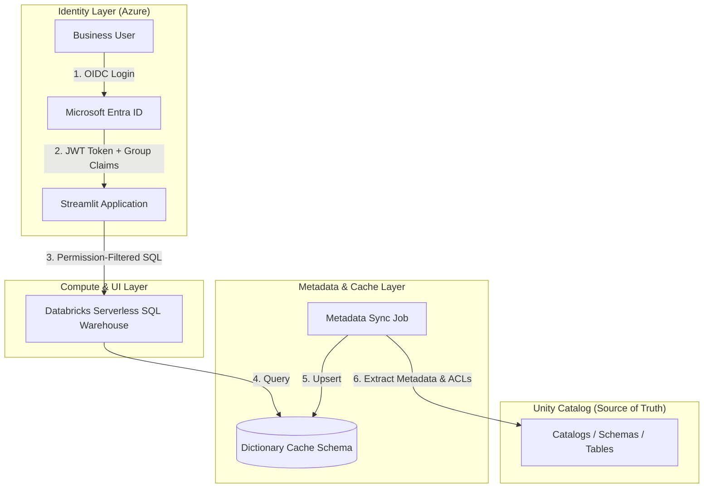

# 🏗️ Business Data Dictionary: Architectural Overview

This document provides a technical and structural overview of the Business Data Dictionary solution for Databricks Unity Catalog.

## 🌟 Executive Summary
The Business Data Dictionary is a Python-native, high-performance search interface designed for business users. It leverages **Microsoft Entra ID (Active Directory)** for authentication and uses a **"Synced Search Engine"** pattern to provide a fast, secure, and permission-aware view of your organization's data assets.

---

## 🏗️ System Architecture

The solution architecture consists of four distinct layers working in harmony to deliver a secure and responsive user experience.

---

## 🧩 Core Components

### 1. The Identity & Security Layer (Microsoft Entra ID)
*   **Mechanism:** Standard OAuth 2.0 / OpenID Connect (OIDC) flow.
*   **Authentication:** Authenticates the corporate identity of the user.
*   **Authorization:** The application extracts the **Security Group Object IDs** directly from the user's `groups` claim in the Identity Token.
*   **Zero Latency:** No call to an external database is required to check user roles; the token itself proves their group memberships.

### 2. The Engine (Python Metadata Sync Job)
*   **Technology:** Python script utilizing the `databricks-sdk`.
*   **Function:** A background "crawler" that traverses the Unity Catalog hierarchy.
*   **Data Extraction:**
    *   **Structural:** Catalog, Schema, Table, and Column names.
    *   **Business Context:** Comments, Tags, and Data Quality statistics.
    *   **Permission Mapping:** Every `GRANT` permission in Unity Catalog is extracted to build an ACL (Access Control List) mapping tables to AD Groups.

### 3. The Performance Layer (Databricks SQL Warehouse)
*   **Role:** Acts as the search-optimized "Index" for the Data Dictionary.
*   **Database:** A dedicated schema (`data_governance.dictionary_cache`) within Unity Catalog.
*   **Optimized Tables:**
    *   `tables_metadata`: Physical path, type, and primary `COMMENT`.
    *   `columns_metadata`: Detailed column-level definitions for technical clarity.
    *   `permissions_cache`: A high-performance mapping of `Table_Name` ↔ `AD_Group_Principal`.
    *   `lineage_cache`: 1-hop table-to-table lineage edges.
    *   `object_tags`: Key-value properties extracted from Catalogs, Schemas, and Tables (used for Glossary and Stewardship).
*   **Efficiency:** Using a **Serverless SQL Warehouse** ensures sub-second query latency and automatic scaling.

---

## 🏷️ Glossary & Business Semantics Mapping

The Business Glossary is dynamically generated by mapping Unity Catalog metadata properties to business concepts:

| Glossary Field | Unity Catalog Implementation | Cache Table |
| :--- | :--- | :--- |
| **Term Name** | Table or Column Name | `tables_metadata` |
| **Definition** | Primary `COMMENT` property | `tables_metadata` |
| **Calculation** | Table Tag with key: `calculation` | `object_tags` |
| **Domain** | Schema Tag with key: `domain` | `object_tags` |
| **Steward** | Table Tag with key: `steward` | `object_tags` |
| **Linked Tables** | Natively provided by Table Lineage | `lineage_cache` |

---

### 4. The UI Layer (Streamlit Frontend)
*   **Framework:** [Streamlit](https://streamlit.io/), a Python-native web framework.
*   **Dynamic Security Enforcement:** Every search query executed by the frontend includes a mandatory `JOIN` with the `permissions_cache` table.
*   **Privacy by Design:** If a user does not belong to the AD group authorized for a specific table, that table is mathematically excluded from the SQL results before they even reach the browser.

---

## 🛡️ Strategic Benefits

1.  **Unified Governance:** Permissions are defined once in Unity Catalog and automatically honored by the Data Dictionary.
2.  **Enterprise Performance:** By caching metadata, the UI remains lightning-fast regardless of the size or complexity of the underlying data platform.
3.  **Low Maintenance:** The entire stack is built with managed, serverless components and maintained with standard Python/SQL skillsets.
4.  **Business Digestibility:** Transforms technical database objects into a searchable business glossary by highlighting comments and data tags.
