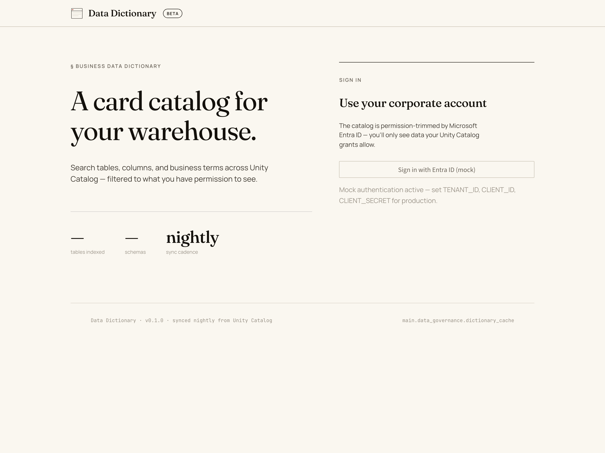
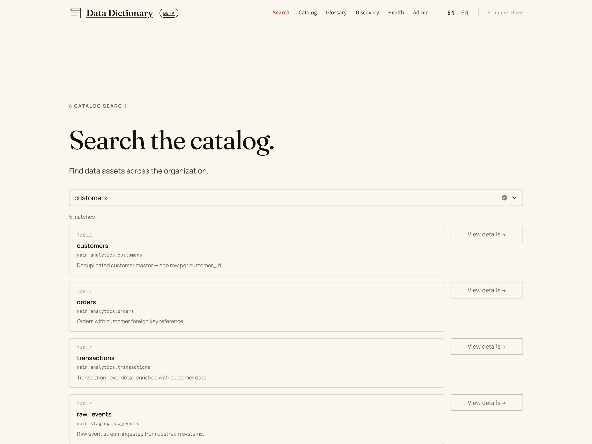
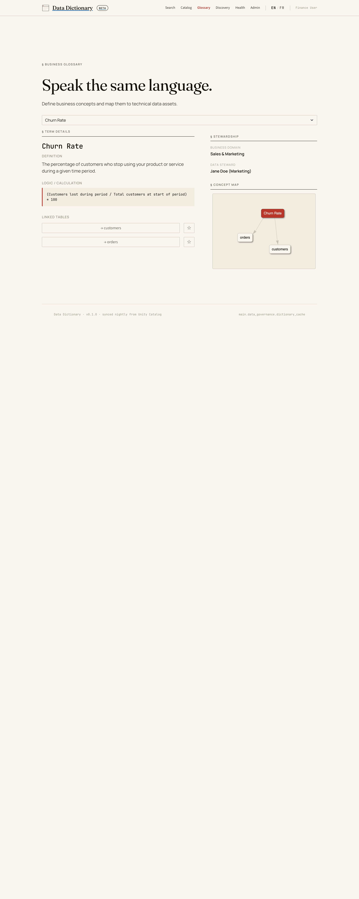

# Business Data Dictionary for Unity Catalog


Business Data Dictionary is an enterprise-grade metadata browser for Databricks Unity Catalog. It gives business users a fast, searchable, permission-filtered view of their organization's data assets — tables, columns, business terms, lineage, and data quality — without requiring direct Databricks access or SQL knowledge. Authentication is handled via Microsoft Entra ID; permissions are enforced in the query engine, not in Python, so users can only ever see what they are authorized to see.

---

## Screenshots

| Sign in | Search results | Glossary term detail |
|---------|---------------|---------------------|
|  |  |  |

---

## Architecture

- The **Streamlit frontend** (`app.py`) authenticates users via OIDC, serves all queries from a local DuckDB cache, and renders five tabs: search, catalog, discovery, health, and glossary.
- The **nightly sync job** (`scripts/sync_metadata.py`) crawls Unity Catalog and atomically rebuilds the local DuckDB cache file, keeping the UI fast without live Databricks queries.
- A **two-file DuckDB cache** separates the sync-owned catalog file (`DUCKDB_PATH`) from the app-owned user data file (`USER_DATA_PATH`), enabling cross-file JOINs for bookmarks and business name overrides without any write contention between the sync job and the app.

For a full technical description of the system design, security model, i18n, and deployment topology, see [ARCHITECTURE.md](ARCHITECTURE.md).

---

## Prerequisites

- Python 3.11+
- Databricks workspace with Unity Catalog enabled
- Microsoft Entra ID app registration (for OIDC auth)

---

## Installation

```bash
git clone <repository-url>
cd datadictionnary
pip install -r requirements.txt
cp .env.example .env
# Edit .env with your credentials
```

---

## Configuration

| Variable | Description |
|----------|-------------|
| `DATABRICKS_HOST` | Workspace URL (e.g. `adb-xxx.azuredatabricks.net`) |
| `DATABRICKS_HTTP_PATH` | SQL Warehouse HTTP path |
| `DATABRICKS_TOKEN` | Personal access token for the sync job |
| `TENANT_ID` | Entra ID tenant ID |
| `CLIENT_ID` | App registration client ID |
| `CLIENT_SECRET` | App registration client secret |
| `REDIRECT_URI` | Must match app registration (e.g. `http://localhost:8501`) |
| `ENABLE_MOCK_AUTH` | `true` to bypass Entra ID during local development |
| `ENVIRONMENT` | `development` to enable mock auth |
| `DEMO_DATA` | `true` to use built-in sample data (no Databricks connection needed) |
| `EDITOR_GROUPS` | Comma-separated Entra ID group object IDs that may edit business names |
| `ADMIN_GROUPS` | Comma-separated Entra ID group object IDs that may access the admin dashboard |
| `DUCKDB_PATH` | Path to the local catalog cache file (e.g. `dict.duckdb`). Leave blank to always query Databricks directly |
| `SMTP_HOST` / `SMTP_PORT` | SMTP server for comment notification emails |
| `SMTP_USER` / `SMTP_PASSWORD` / `SMTP_FROM` | SMTP credentials |

---

## Running the app

The sync job must run before the app has any data.

```bash
# 1. Sync metadata from Unity Catalog
python scripts/sync_metadata.py

# 2. Start the frontend
streamlit run app.py
```

The sync job writes to the Databricks cache and, if `DUCKDB_PATH` is set, exports a local DuckDB snapshot. Subsequent syncs atomically replace the catalog file without interrupting in-flight reads.

---

## Development mode

For local UI development without any Databricks or Entra ID dependency:

```bash
# Generate the test dataset (800 tables, 4 departments)
python scripts/generate_test_data.py --seed 42 --out data/test_data.duckdb
```

Then set in `.env`:

```bash
ENABLE_MOCK_AUTH=true
ENVIRONMENT=development
DUCKDB_PATH=data/test_data.duckdb
EDITOR_GROUPS=finance_dept_id
ADMIN_GROUPS=finance_dept_id
```

The sign-in page will show department-specific mock login buttons (finance, research, hr, it). Each button injects the appropriate group IDs into the session so the permission JOIN filters results exactly as in production.

---

## Security model

**Authentication** — OIDC via Microsoft Entra ID. The `groups` claim in the ID token is used to determine group membership.

**Authorization** — Every search query JOINs `tables_metadata` with `permissions_cache WHERE principal IN ($user_groups)`. No Python-side filtering is applied — unauthorized rows are never returned from the engine. The sentinel value `SELECT_ALL_USERS` in `permissions_cache.principal` marks publicly accessible tables.

**Feature access** — `EDITOR_GROUPS` controls who can save comments and business name overrides. `ADMIN_GROUPS` controls who can access the admin dashboard and audit logs (no demo bypass).

**Hardening** — User-supplied display names are HTML-escaped before rendering. SMTP headers are sanitized to prevent header injection.

---

## Test suite

```bash
python -m pytest --tb=short -q
```

See [tests/README.md](tests/README.md) for full test documentation including load test commands, dataset generation, and SLA targets.

---

## Project structure

```
app.py                    Main Streamlit application and design system CSS
scripts/
  sync_metadata.py        Unity Catalog crawler and DuckDB/SQL exporter
  generate_test_data.py   Deterministic test dataset generator
tests/
  conftest.py             Shared fixtures and SQL mock helpers
  test_app.py
  test_admin.py
  test_duckdb_cache.py
  test_navigation.py
  test_sync_metadata.py
  load/
    locustfile.py         Load test scenarios (HTTP + DuckDB query layer)
    sla.json              SLA targets for p95/p99 latency
locale/
  en.json                 English UI strings
  fr.json                 French UI strings
design_system/
  colors_and_type.css     Design tokens (CSS variables)
  README.md               Full design system specification
  ui_kits/app/            React JSX prototypes of every screen
k8s/                      Kubernetes manifests
docs/
  adr/                    Architecture decision records
  api/                    API and locale key references
  runbooks/               Operations runbooks
assets/
  logo-mark.svg
  logo-wordmark.svg
.env.example              Environment variable reference
requirements.txt
```

---

## Contributing

**Branch naming** — use a prefix that matches the change type:
- `feature/<short-description>` for new features
- `fix/<short-description>` for bug fixes
- `chore/<short-description>` for dependency updates, config changes, and housekeeping
- `docs/<short-description>` for documentation-only changes

**Commit messages** — use [Conventional Commits](https://www.conventionalcommits.org/):
```
feat(search): add group filter dropdown
fix(duckdb): handle null description columns
docs: update ARCHITECTURE.md with i18n section
chore: bump streamlit to 1.35
```

**Tests** — all PRs must pass the full pytest suite:
```bash
python -m pytest --tb=short -q
```

There is no coverage gate enforced by CI yet, but new features should include tests for the happy path and at least one error case.
